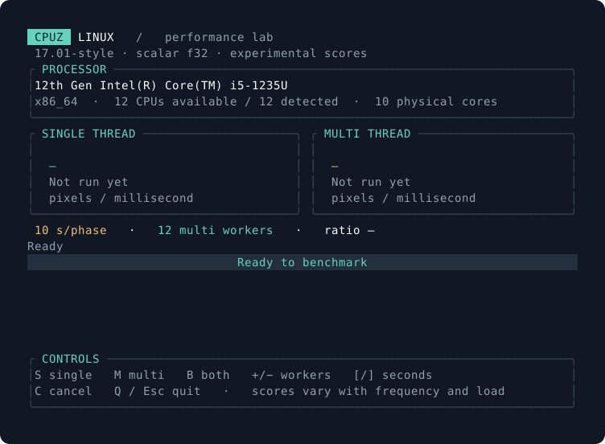

# CPUZ Linux

A CPU benchmark written in Rust for Linux, with a terminal interface, single and multi thread tests, and information about the processor being tested.

**Experimental:** the workload was reconstructed from an investigation of 17.01.SSE x64; numerical and score equivalence with CPU-Z has not been demonstrated. This project is not affiliated with CPUID.



## Getting started

With a recent stable Rust toolchain, Git, and a compiler/linker installed:

```bash
git clone https://github.com/kimlherme/cpuz-linux.git
cd cpuz-linux
cargo build --release --locked
./target/release/cpuz-linux
```

Running the program without arguments in an interactive terminal opens the TUI. Press **S** for single, **M** for multi, or **B** to run both. The top panel shows the CPU model, architecture, available logical CPUs, and detected physical cores. The terminal interface uses English.

Use a release build to measure performance. Debug builds use different optimization settings, so their scores should not be compared with release scores.

## Terminal interface

The TUI displays single and multi result cards, elapsed time, completed work, worker count, and the multi/single ratio. You can adjust settings while no measurement is running.

| Key | Action |
| --- | --- |
| `S` | Run single with one thread |
| `M` | Run multi with the selected worker count |
| `B` | Run multi, then single |
| `+` / `-` | Increase / decrease the multi worker count |
| `[` / `]` | Decrease / increase the duration of each phase |
| `C` | Cancel the current measurement; its result is marked as partial |
| `Q` / `Esc` | Quit |
| `Ctrl+C` | Cancel and quit |

The terminal must be at least 64 columns by 22 rows to display the full dashboard. In a smaller terminal, the application asks you to enlarge the window. Running threads finish before the terminal is restored; cancellation may wait for the current work unit to complete.

The image above illustrates the layout. It does not show a measurement from a reference CPU.

## Running without the TUI

```bash
# Single: one thread, ten seconds
cpuz-linux --mode single --seconds 10 --no-tui

# Multi: CPUs available to the process
cpuz-linux --mode multi --threads auto --seconds 10

# Multi with eight workers, then single with one thread
cpuz-linux --mode both --threads 8 --seconds 10

# Save results as JSON for analysis
cpuz-linux --mode both --threads auto --seconds 10 --json > resultado.json

# Open the TUI with initial settings
cpuz-linux --tui --threads 4 --seconds 15

# Help
cpuz-linux --help
```

If `cpuz-linux` is not on your PATH yet, use `./target/release/cpuz-linux` in these examples.

### Options

| Option | Values | Default |
| --- | --- | --- |
| `--mode` | `single`, `multi`, `both` | `single` |
| `--seconds` | A number from `0.05` to `3600` | `10` per phase |
| `--threads` | `auto` or an integer from `1` to `256` | CPUs available to the process, capped at 256 |
| `--tui` | Open the interactive interface | Enabled without arguments when stdin and stdout are terminals |
| `--no-tui` | Text output | Used when the TUI is not selected |
| `--json` | JSON object, without the TUI | Disabled |
| `-h`, `--help` | Show help | — |

`--threads` configures multi; single always uses one worker. `both` runs two phases: multi followed by single. With `--seconds 10`, this means roughly twenty seconds of measurement, plus setup and cleanup.

Without arguments and without a terminal, the program runs single for ten seconds. `--tui` requires stdin and stdout to be connected to a terminal and cannot be combined with `--json` or `--no-tui`. Invalid values produce an error message and exit code 2.

The TUI waits for a start key. `--mode` does not automatically start a test when the interface opens; S/M/B select the test to run.

## Installing on Linux distributions

The project uses Rust edition 2024 and requires Rust 1.88 or later. Its application dependencies are Rust crates; building also requires native tools to link the executable. The instructions below cover Arch Linux, Ubuntu, Fedora, and openSUSE. See [distribution support](docs/distributions.md) for packaging instructions and details.

### Arch Linux

```bash
sudo pacman -S --needed base-devel git curl rustup
rustup default stable
```

### Ubuntu

```bash
sudo apt update
sudo apt install build-essential git curl ca-certificates
```

If the Rust version available on your system is older than 1.88, install a recent stable toolchain using the universal procedure below. The Rust version in Ubuntu's repositories depends on the Ubuntu release.

### Fedora

```bash
sudo dnf install gcc git curl
```

Use a recent system Rust toolchain or the universal procedure below.

### openSUSE

```bash
sudo zypper install gcc git curl
```

Use a recent system Rust toolchain or the universal procedure below. Rust package availability and versions differ between Leap and Tumbleweed.

### Stable Rust with rustup

The official installer is available at [rustup.rs](https://rustup.rs/). Download the script, inspect it, then run it:

```bash
curl --proto '=https' --tlsv1.2 -sSf https://sh.rustup.rs -o /tmp/cpuz-rustup-init.sh
less /tmp/cpuz-rustup-init.sh
sh /tmp/cpuz-rustup-init.sh --profile minimal --default-toolchain stable
. "$HOME/.cargo/env"
rustc --version
```

If you already use rustup, update your stable toolchain with `rustup update stable`. The project's `rust-toolchain.toml` selects the toolchain channel.

### Install for the current user

After cloning the repository and entering its directory:

```bash
./scripts/install.sh --prefix "$HOME/.local"
```

The installer builds with `--release --locked` and installs the executable, documentation, and manual page under the selected prefix. Make sure `$HOME/.local/bin` is on your PATH, then run `cpuz-linux`.

To remove the files installed under that prefix:

```bash
./scripts/install.sh --prefix "$HOME/.local" --uninstall
```

Installation scripts and package recipes are included in the repository. Documented installation instructions do not mean that every release of every distribution has been tested manually; check the actual CI results and validation record.

## What the score measures

The unit recovered for the original 17.01 x64 single test is **counted pixels per millisecond**. Each pixel requires 34 evaluations of 2D noise, plus color composition.

```text
score = float32(counted pixels) / float32(measured time in whole milliseconds)
```

A score of 500 corresponds to roughly 500,000 pixels per second for this workload. The calculation runs on the CPU; these points are neither GPU frames nor GHz. In the original application's absolute score display path that was inspected, the score is shown to one decimal place, without a reference CPU calibration factor.

Multi executes the workload across multiple threads and sums the work accepted by the measurement policy. The multi/single ratio is the multi score divided by the single score. Turbo behavior, temperature, SMT, and power limits also affect that ratio.

Each worker uses a private 4 MiB buffer in addition to other data structures. A large worker count increases memory use and competition for resources; 256 workers require about 1 GiB for buffers alone. The maximum accepted by the interface is not a recommended setting for performance.

## JSON and automation

`--json` writes an object with `schema_version: 1`. Its main fields are:

| Field | Contents |
| --- | --- |
| `algorithm` | Identifier of the implemented workload |
| `experimental` | Experimental status |
| `cpu` | CPU model, architecture, and CPU counts |
| `configuration` | Parsed execution settings |
| `results` | One entry per executed phase |
| `multi_single_ratio` | Ratio when valid single and multi results are available; otherwise `null` |

Each result contains `mode`, `threads`, `pixels`, `elapsed_ms`, `score`, `checksum`, `worker_pixels`, and `cancelled`. `worker_pixels` lets you check the sum of work across workers. The checksum summarizes the final buffer state; because the amount and position of work depend on timing, it is not a fixed reference vector for equivalence with the original.

For comparisons, keep complete results and record the commit, compiler, power profile, affinity, and temperature. Run multiple repetitions and compare the spread as well as the median. The user reported 523 from the Linux CLI and 535 from CPU-Z on Windows, a difference of about 2.24%; that isolated report does not establish equivalence.

## Investigation documentation

The detailed documents below are currently in Portuguese.

- [Full 17.01 x64 investigation](docs/reverse-engineering.md): artifacts and hashes, extraction, classes, simplex noise, gradients, fields, pixels, threads, scoring, interface, and export behavior.
- [Evidence index](docs/evidence-index.md): Evidence IDs, operations, addresses, and limits of each conclusion.
- [Measurement and validation methodology](docs/methodology.md): frequency, turbo, hybrid cores, repetitions, and Windows/Linux comparisons.
- [Implementation architecture](docs/architecture.md): Rust components, multi worker organization, timing, counting, checksum, and interface.
- [Distributions and installation](docs/distributions.md): Arch, Ubuntu, Fedora, and openSUSE.
- [Completed validation](docs/validation.md): tests, TUI checks in a pseudo-terminal, and results across the four distributions.

The investigation covered 17.01.SSE x64 in detail. The 19.01.SSE, 19.01.AVX2, and 19.01.AVX512 variants were identified in the executable, but this CLI does not claim to implement them. The numerical table, reference pixels, and the original's full end-of-run policy still require validation.

The reverse engineering process and the implementation informed by it are described explicitly. This project does not claim to have completed a clean room process with verifiable isolation of the implementer.

## License

The code in this repository is distributed under [GPL-2.0-only](LICENSE). CPU-Z and CPUID are names belonging to their respective owners. The project's license does not grant rights to the proprietary executables that were analyzed; those executables are not distributed here.
