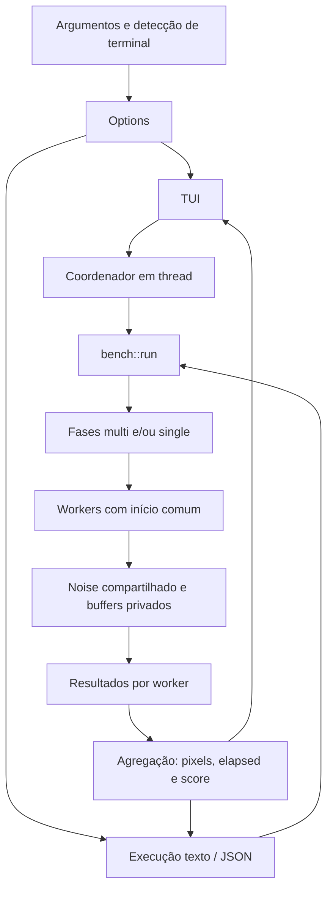

# Arquitetura da implementação Rust

Esta descrição se refere à reconstrução experimental do repositório. Os mecanismos do original Windows estão documentados separadamente em [investigação](reverse-engineering.md). A fórmula de score observada orienta a implementação; a política de threads Linux é uma adaptação própria.

## Componentes

| Arquivo | Responsabilidade |
| --- | --- |
| `src/main.rs` | Inicialização, seleção TUI/texto, apresentação e JSON |
| `src/cli.rs` | Parsing e limites de parâmetros |
| `src/cpu.rs` | Identificação da CPU e topologia disponível |
| `src/noise.rs` | Tabela, gradientes, núcleo, campos e escrita de linhas |
| `src/bench.rs` | Workers, janela de medição, contagem e resultados |
| `src/tui.rs` | Layout, teclado, progresso e cancelamento |
| `src/lib.rs` | Exportação dos módulos reutilizados |



## CPU e quantidade de threads

A identificação usa informações disponíveis no sistema Linux. A contagem de CPUs disponível ao processo pode ser menor que a detectada no hardware. O padrão de workers usa `std::thread::available_parallelism`, limitado a 256, com fallback de uma thread.

Single sempre cria um worker. Multi usa a quantidade configurada. O programa não fixa prioridade em tempo real nem seleciona automaticamente um núcleo de melhor desempenho. Uma afinidade externa, por exemplo com `taskset`, é uma condição do experimento e deve ser registrada.

O modelo vem do primeiro campo `model name` ou `Hardware` disponível em `/proc/cpuinfo`, com fallback para CPU desconhecida. A arquitetura vem de `std::env::consts::ARCH`. Os núcleos físicos são estimados pelos pares distintos de `physical id` e `core id`; essa visão pode representar o host e não apenas o conjunto permitido ao processo.

A contagem de núcleos físicos depende dos dados que o sistema expõe. Em caso de ausência, a interface mostra um valor desconhecido. O modelo reportado identifica a CPU, sem comprovar o núcleo específico ou a frequência efetiva durante a carga.

## Implementação numérica atual

A carga usa float32 e uma tabela de 4096 valores. Na versão atual, o preenchimento chama `f32::sin` com uma expressão de fase em float32. Esse seno do ambiente Linux substitui a auxiliar original ainda não completamente especificada; não existe afirmação de igualdade bit a bit.

Os canais usam limitação a 0..1 e conversão para `u8`. Essas escolhas seguem a estrutura recuperada para entradas normais, mas diferenças de biblioteca matemática, arredondamento e conversões precisam ser verificadas contra vetores do original. As quatro sequências mantêm 10 + 10 + 7 + 7 avaliações por pixel.

## Preparação da fase

Cada fase cria uma instância da carga e compartilha seus dados imutáveis entre workers com `Arc`. Cada worker aloca seu próprio buffer de 1024 × 1024 × 4 bytes e toca suas páginas antes do início comum da medição.

A preparação usa um canal para informar que cada worker está pronto. Os workers esperam em uma `Condvar` protegida por mutex. Quando todos estão prontos, o coordenador registra um `Instant` comum e libera a condição.

Esse arranjo exclui a alocação e o primeiro toque das páginas da janela principal. A latência de despertar após a liberação ainda pertence à execução medida. Ele também evita que um worker receba dez segundos adicionais só porque foi criado depois de outro.

Se a criação de uma thread falha, o gate é abortado, as threads existentes são liberadas e recolhidas, e a fase retorna erro. A aplicação não publica como execução completa uma fase com menos workers que o solicitado.

## Distribuição do trabalho

Cada unidade calcula uma linha de 1024 pixels. O worker começa com índice de job igual ao seu identificador e avança por um passo igual ao número de threads.

```text
job inicial = identificador do worker
linha = job % 1024
frame/deslocamento = job / 1024
próximo job = job + quantidade de workers
```

O índice de linha seleciona a região do buffer privado onde os quatro bytes de cada pixel serão escritos. O frame/deslocamento modifica a coordenada usada pela carga ao repetir a grade.

No multi, workers diferentes percorrem subsequências distintas. Como cada um possui buffer próprio, não há escrita concorrente no mesmo slice de pixels. A tabela imutável pode ser compartilhada.

Essa política não é uma reprodução literal de `QueueUserAPC`, eventos ou grupos de processadores do Windows. O número de workers e a quantidade de trabalho aceita são observáveis no resultado.

## Deadline e contabilidade

O worker verifica cancelamento e tempo antes de iniciar uma linha. Ao terminar, verifica novamente. A linha só entra na contagem se a janela ainda estiver aberta e não houver pedido de cancelamento.

Uma linha que cruza o deadline já consumiu tempo de CPU e pode ter alterado o buffer, mas não aumenta `pixels`. Essa distinção evita atribuir uma unidade completa a uma janela na qual ela não terminou.

O worker registra seu instante de término antes de calcular checksum. O elapsed agregado é a maior diferença entre esse término e o início comum, truncada para milissegundos e limitada a pelo menos 1 ms. Assim, a última linha rejeitada pode alongar o divisor; a soma do tempo de hashing e a espera de join não entram nesse elapsed.

```text
pixels totais = soma(pixels aceitos por worker)
elapsed_ms = max(tempo até término de cada worker), em ms inteiros
score = float32(pixels totais) / float32(elapsed_ms)
```

O contador é `u64`. O score é `f32`, de acordo com a unidade recuperada. Essa escolha não prova equivalência com a política de coleta do original, cujos detalhes no encerramento ainda exigem confirmação em execução.

A atualização atômica de progresso acontece após cada linha aceita. Ela tem custo dentro da janela medida, tanto em modo texto como na TUI. A renderização da interface fica fora dos workers, mas disputa os recursos do sistema.

## Consumo de saída e checksum

A carga escreve pixels em memória, e `std::hint::black_box` ajuda a impedir que o compilador trate o trabalho como irrelevante. Após o término medido, cada buffer recebe um hash FNV-1a de 64 bits. Os hashes dos workers são combinados com rotação e identificação do worker.

Esse checksum resume o estado final daquela execução. Não é um checksum canônico da grade de referência: o tempo determina quantas linhas foram visitadas, e a última linha escrita pode ter sido rejeitada pela contagem. Workers com diferentes velocidades também podem terminar em estados diferentes.

Para validar a função numérica contra o original, deve existir uma execução de quantidade fixa e coordenadas fixas, com bytes de referência correspondentes. Dois checksums distintos entre execuções cronometradas não significam automaticamente erro matemático; dois checksums iguais sem referência original não comprovam compatibilidade.

## Fases e razão

`single` executa uma fase de um worker. `multi` executa uma fase com os workers selecionados. `both` executa multi e depois single. A duração informada vale para cada fase, não para o conjunto.

A implementação não introduz a pausa Windows `Sleep(10)` entre fases. Cada fase prepara suas próprias estruturas. A razão multi/single só é produzida quando existem resultados completos de ambos os modos e o score single é positivo.

Na TUI, os últimos cartões podem permanecer de execuções anteriores. A razão exibida pode relacionar os últimos resultados de cada modo, inclusive quando foram obtidos em momentos distintos; use `both` e o JSON daquela execução para uma comparação pareada.

## TUI e cancelamento

A interface usa Ratatui e Crossterm. O estado da tela mantém configurações, CPU, últimos resultados, status e uma execução ativa. Ao iniciar um teste, cria um coordenador separado e recebe o resultado por canal.

O teclado é processado com polling de aproximadamente 100 ms. Enquanto há execução, as teclas de configuração e de início são ignoradas; cancelar e sair continuam disponíveis. O flag de cancelamento é compartilhado e lido nos limites de linha.

Cancelar produz um resultado parcial identificado. Sair solicita cancelamento e aguarda o coordenador. A restauração do terminal ocorre após o encerramento das threads controladas pela interface. A duração dessa espera depende da unidade atual, não apenas do intervalo de polling.

O modo texto/JSON não usa o coordenador de interface. `Ctrl+C` nesse modo segue o tratamento normal de sinais do processo; não se deve presumir um relatório parcial idêntico ao cancelamento cooperativo da TUI.

## Saída estruturada

O JSON tem `schema_version: 1` e inclui identificação de algoritmo, estado experimental, CPU, configuração interpretada, vetor de resultados e razão opcional. Cada fase fornece score, elapsed, pixels, distribuição por worker, checksum e estado de cancelamento.

A configuração guarda os workers solicitados para o multi. Em uma fase single, o campo `threads` do próprio resultado é 1; esse campo é a quantidade efetivamente usada naquela fase.

A saída numérica completa é útil para auditoria. O texto e a TUI arredondam o score para uma casa decimal; a serialização JSON preserva a representação do valor `f32`, permitindo recomputar e examinar diferenças sem depender da apresentação.

## Limites de memória e desempenho

Cada worker mantém 4 MiB de buffer, além de stack e estruturas de controle. Com 256 workers, os buffers somam aproximadamente 1 GiB. A quantidade de threads aceita não significa que o sistema tenha recursos ou núcleos para executá-la de forma eficiente.

Não há calibração para uma CPU de referência. O projeto pode precisar ajustar detalhes matemáticos para atingir fidelidade, mas um multiplicador escolhido para aproximar um score específico esconderia esse problema.

Compilação release, frequência, temperatura, afinidade e limites de cgroup continuam influenciando os resultados. Consulte [metodologia](methodology.md) antes de comparar com CPU-Z ou entre máquinas.
