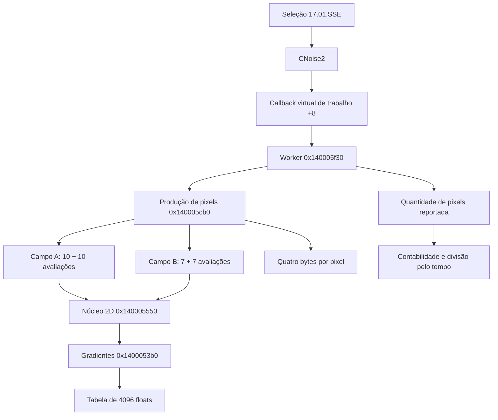

# Investigação do benchmark CPU-Z 17.01 x64

Este documento descreve o que foi recuperado por análise estática do CPU-Z 3.01 e como esses achados orientaram este benchmark experimental para Linux. O objetivo é permitir a revisão das unidades de trabalho, da pontuação e das limitações da reconstrução. Não é o código-fonte original do CPU-Z, nem uma demonstração de equivalência entre os programas.

A investigação original ocorreu em 14 de outubro de 2026, em duas passagens: localização da carga e rastreio da pontuação single até a interface e um caminho de exportação. O CPU-Z não foi executado nessas passagens. Os resultados relatados posteriormente pelo usuário são apresentados separadamente em [metodologia](methodology.md).

## O que está estabelecido

| Pergunta | Resultado | Natureza |
| --- | --- | --- |
| Qual carga foi seguida em detalhe? | 17.01.SSE x64, classe CNoise2 | Análise estática |
| Qual núcleo matemático aparece? | Ruído 2D com estrutura de simplex | Inferência algorítmica apoiada no código |
| Quanto trabalho existe por pixel? | 10 + 10 + 7 + 7 = 34 avaliações do núcleo | Contagem de loops |
| Qual domínio? | Grade 1024 × 1024, quatro bytes por pixel | Constantes e alocação |
| Como o single vira pontos? | Pixels contabilizados / milissegundos medidos inteiros, em float32 | Assembly |
| Existe multiplicador por CPU de referência? | Nenhum no caminho absoluto seguido até UI/export | Resultado limitado a esses caminhos |
| Como aparece na tela? | Uma casa decimal | Formatador |
| A implementação Linux já é numericamente equivalente? | Não demonstrado | Faltam vetores do original |
| Os scores já são intercambiáveis? | Não demonstrado | Faltam comparações controladas |

## Identidade dos artefatos

Os nomes abaixo são aliases de investigação; os executáveis proprietários não integram este repositório.

| Alias | Descrição | SHA-256 |
| --- | --- | --- |
| `artifacts/cpu-z_3.01-en.exe` | Setup PE32 fornecido pelo usuário | `74ab9b1c24fb223d0a5c23e2e444b6cbba7d0c6882cc4bf389e3f88bfca37490` |
| `artifacts/x86/cpuz.exe` | Executável x86 extraído | `1454f1d8e6c2b4016aba1f5c1918a3b8bc33113bdadc066e7edc62f9f5e1fcd8` |
| `artifacts/x64/cpuz.exe` | Executável x64 analisado | `a01369043c9e199747d62b950fb6db3f793ea74feb9c667ae291988405905fbe` |
| `tools/innoextract-source.tar.gz` | Fonte do extrator utilizado | `e41d0775809208076c4fe05af3a87a04be4f3ed23242b2ba836ac16ad8d49a62` |
| `tools/innoextract` | Extrator compilado localmente | `cab7b609abeda66ad4880527cc54e66d67902b743850a953f12ff047fbdbfa4e` |

Todos os endereços virtuais deste documento se referem ao executável x64 desse hash. Eles não são offsets de arquivo nem endereços estáveis entre versões. A análise não permite transportar essas localizações para outro CPU-Z sem reidentificar o binário.

### Extração

O setup foi extraído sem execução. O innoextract 1.9 não tratou corretamente os cabeçalhos Inno Setup 6.3.0 deste arquivo. Foi compilado localmente um innoextract 1.10-dev a partir do projeto oficial, sem instalar pacotes no sistema.

O pacote contém dois membros chamados `cpuz.exe`. A extração com `--collisions rename` preservou os dois; o segundo recebeu o sufixo `$0` na pasta da investigação. O hash e a arquitetura, e não apenas esse nome, definem qual executável foi analisado.

### Ferramentas e procedência

A análise nativa utilizou REA com Ghidra 12.1.2. A investigação guardou registros de evidência com operação, parâmetros, resultado e limitações. A seleção usada para produzir esta documentação foi `focused-evidence.json` e `score-single-focused-evidence.json`, junto aos relatórios locais e à lista SHA256SUMS.

O executável referencia `cpuz_x64.pdb`, mas esse PDB não foi carregado. Nomes como `FUN_140005550` são rótulos do analisador. Nomes de classes recuperados por RTTI ajudam a localizar os objetos; isso não recupera todos os nomes originais de funções ou variáveis.

Os Evidence IDs em [índice de evidências](evidence-index.md) permitem relacionar cada conclusão aos registros privados originais. Os bundles de análise, os binários e grandes saídas de assembly/descompilação não são redistribuídos aqui. Assim, o índice é um mapa da investigação, e não uma afirmação de que todo leitor consegue reexecutá-la apenas com este repositório.

## Contexto público e limite entre versões

A [publicação oficial da CPUID sobre o benchmark 2017.01](https://www.cpuid.com/news/51-cpu-z-1-79-new-benchmark-new-scores.html) descreve ruído 2D para geração procedural. Ela contextualiza uma implementação histórica em C++, com Visual C++ 2008, SSE/SSE2 escalar em x64 e x87 em x86. Também informa a incompatibilidade entre scores dos algoritmos de 2015 e 2017.

Essa informação histórica não identifica o compilador de todo o aplicativo 3.01 e não especifica automaticamente o algoritmo 19.01. Neste projeto, o comportamento do alvo fornecido é sustentado pela análise desse alvo; o artigo é apoio histórico.

### Grupos encontrados

| Nome interno | VA da string x64 | Campo do controlador |
| --- | --- | --- |
| 17.01.SSE | `0x14042e970` | `+0x58` |
| 19.01.SSE | `0x14042e988` | `+0x60` |
| 19.01.AVX2 | `0x14042e9a0` | `+0x68` |
| 19.01.AVX512 | `0x14042e9b8` | `+0x70` |

Os objetos de score são efetivamente criados, além de seus nomes existirem como strings. Isso não prova que todas as opções estejam habilitadas numa CPU específica.

O seletor na região de `0x140349f80`, com corpo analisado a partir de `0x140349fd2`, associa a parte alta `0x17016400` dos identificadores a CNoise2 e `0x19016400` a CNoise3. O byte baixo participa da distinção entre variantes 19.01 em outros pontos.

### Objetos e tabelas virtuais

| Componente recuperado | VA da vtable |
| --- | --- |
| CNoise2 | `0x1404387f8` |
| CNoise3 | `0x140436da0` |
| NoiseImpl | `0x140436e48` |
| NoiseAVX2ImplV2 | `0x140436d50` |
| NoiseAVX512Impl | `0x140436d78` |

A associação usa RTTI, referências e tabelas virtuais. CNoise3 e as implementações vetoriais foram identificadas, mas não reconstruídas integralmente. A CLI não deve apresentar sua carga 17.01 como implementação das variantes 19.01.

## Caminho seguido no 17.01



| Responsabilidade | VA x64 |
| --- | --- |
| Inicialização de CNoise2 | `0x1400052e0` |
| Gradientes | `0x1400053b0` |
| Núcleo simplex 2D | `0x140005550` |
| Primeiro campo | `0x1400058a0` |
| Segundo campo | `0x140005aa0` |
| Composição e escrita de pixels | `0x140005cb0` |
| Callback worker | `0x140005f30` |
| Medição multi | `0x140318a10` |
| Medição single | `0x140318e40` |

### Geometria do núcleo

O núcleo transforma as coordenadas para uma grade de triângulos, escolhe um dos dois triângulos da célula e calcula três contribuições de gradiente, uma por vértice. Isso sustenta a identificação como simplex noise 2D; não havia um nome original completo de função que estabelecesse essa identidade sozinho.

| Constante decimal observada | Interpretação geométrica aproximada |
| --- | --- |
| `0.36602542` | `(sqrt(3) - 1) / 2`, transformação inicial |
| `0.21132487` | `(3 - sqrt(3)) / 6`, transformação inversa |
| `0.42264974` | Duas vezes a constante anterior |
| `0.5` | Termo de suporte radial |

O índice da célula exige piso matemático. O código observado começa com conversão truncada e corrige quando o valor original é menor que o inteiro convertido. Para entradas negativas, converter simplesmente para inteiro não é equivalente.

A contribuição de cada vértice usa o produto escalar entre gradiente e deslocamento, ponderado pela quarta potência de um termo radial limitado a zero. A seleção do triângulo depende da comparação entre as duas coordenadas locais. A igualdade nessa comparação é uma fronteira relevante para testes.

Os decimais acima são formas legíveis dos valores recuperados. Uma especificação destinada à equivalência bit a bit deve fixar os padrões binários float32 e a ordem de cada operação; recalcular as expressões em float64 e converter no fim pode produzir outros bits.

### Geração de gradientes

A inicialização aloca 4096 floats, aproximadamente 16 KiB. O gerador consulta essa tabela a partir de combinações das coordenadas da grade.

Os pares de coeficientes recuperados são `(127.1, 311.7)` e `(269.5, 183.3)`. O fator `0.15915495`, próximo de `1/(2π)`, participa da redução das fases. Há multiplicação pelo tamanho de tabela e por `43758.547`, seguida de extração de parte fracionária e transformação para componentes de gradiente.

Há duas semânticas que precisam ser distinguidas: a fase negativa tem uma correção para cair no intervalo de indexação; a extração posterior usa truncagem para inteiro. Substituir todas essas operações por uma única função genérica `fract`, `floor` ou módulo pode mudar o resultado.

A primeira investigação não fechou a função auxiliar que preenche a tabela. Uma tabela construída com seno de uma biblioteca do Linux é uma decisão de reconstrução enquanto não houver vetores ou bytes de referência que comprovem igualdade. Também não basta concluir que a tabela contém senos porque o fator de fase lembra `1/(2π)`.

### Campos procedurais

O primeiro campo tem duas sequências de dez avaliações. A entrada é escalada por `1.1/1024`. Uma sequência acumula magnitudes com peso inicial 0.8 e decaimento 0.7; a outra usa valores com sinal, peso inicial 0.7 e decaimento 0.6. Há ganho 40 nas contribuições e uma combinação não linear dos acumuladores, com ganho 8 e deslocamento 0.2.

O segundo campo tem duas sequências de sete avaliações. A primeira usa escala `2.2/1024`, valores com sinal, peso inicial 0.4 e decaimento 0.6. A segunda usa escala recuperada como `3.3000002/1024`, magnitudes, peso inicial 0.4 e o mesmo decaimento. As duas contribuições são somadas.

Entre avaliações, as coordenadas são transformadas por uma matriz com coeficientes 1.6 e 1.2: uma componente combina `1.6 × x - 1.2 × y`; a outra combina `1.2 × x + 1.6 × y`. Os dois novos componentes devem usar as coordenadas anteriores; atualizar um deles antes de calcular o outro mudaria a carga.

A soma dos comprimentos dos loops é 34 avaliações de núcleo por pixel. Como cada núcleo consulta três gradientes, a composição envolve 102 consultas ao gerador de gradientes por pixel, no caminho sem atalhos observado. Isso é uma contagem estrutural, não uma medida de instruções ou de operações efetivamente aposentadas pela CPU.

### Cores e buffer

O domínio definido pelo controlador tem 1024 × 1024 pixels. A alocação observada é `0x400000` bytes: 4.194.304 bytes ou 4 MiB. Cada pixel ocupa quatro bytes; o quarto é fixado em 255.

Os dois campos alimentam misturas de três canais. Os valores são limitados ao intervalo de 0 a 1, combinados com cores de base, multiplicados por 255 e convertidos para inteiros antes da escrita. Os deslocamentos identificados incluem 0.1, 0.2 e 0.3, e cores de base com componentes 0.2, 0.4 e 0.6.

O layout pode ser descrito operacionalmente como quatro bytes de cor e opacidade, ou RGBA na reconstrução. A interpretação visual RGB/BGR por uma API de exibição não foi validada. Para comparação funcional, a sequência de bytes escrita é o contrato relevante.

O benchmark repete unidades da grade. Por isso, um contador total pode superar 1.048.576 pixels sem exigir um buffer maior. A unidade seguida no caminho single tem comprimento de 1024 pixels e é reportada pelo worker quando termina.

### SSE escalar

O assembly do núcleo x64 contém `ADDSS`, `MULSS`, `SUBSS` e conversões escalares. A presença de registradores XMM não implica que vários pixels sejam calculados em paralelo. O caminho examinado executa operações escalares no núcleo.

Essa afirmação não inventaria todas as instruções de todo o executável. Também não garante que o Rust/LLVM gere a mesma sequência. Inlining, vetorização de loops, operações fundidas e melhor alocação de registradores podem alterar a velocidade mesmo quando os pixels coincidem.

## Da carga à pontuação

### Unidade e janela

O controlador solicita 10000 ms por fase. A sequência observada executa multi, espera `Sleep(10)` e executa single. A constante de duração é um alvo; o divisor final usa o tempo efetivamente medido.

Para o caminho single concluído normalmente:

```text
tempo_ms = trunc((ticks_finais - ticks_iniciais) × 1000 / frequência)
score = float32(pixels_contabilizados) / float32(tempo_ms)
```

A divisão dos ticks é inteira e precede as conversões para ponto flutuante. Para tempos positivos, truncagem equivale a piso. A unidade do resultado é pixels por milissegundo, numericamente igual a milhares de pixels por segundo.

Isso não representa milhões de instruções por segundo, frames por segundo, GHz ou uma avaliação da qualidade da imagem. Também não é uma medida da GPU.

### Exemplo de 500 pontos

| Etapa | Valor ilustrativo |
| --- | ---: |
| Unidades concluídas e coletadas | 4883 |
| Pixels por unidade | 1024 |
| Pixels contabilizados | 5.000.192 |
| Tempo medido | 10.000 ms |
| Quociente matemático | 500,0192 |
| Quociente float32 | 500,0191955566406 |
| Exibição com uma casa decimal | **500.0** |
| Exportação inteira inspecionada | **500** |

Esse exemplo foi calculado a partir da fórmula. Não é um resultado observado num processador. Muitas combinações de quantidade e tempo terminam com o mesmo texto após arredondamento.

### Contabilidade no encerramento

Em `0x140319045`, o controlador soma ao contador o trabalho reportado pelo worker no campo `+0x3c`. A leitura final do relógio aparece em `0x140319179`. A multiplicação por 1000, divisão inteira pela frequência e conversões aparecem entre `0x140319199` e `0x1403191a9`; a divisão float final aparece em `0x1403191bc`.

O epílogo não mostrou uma coleta final adicional de unidades ainda pendentes. Uma implementação Linux que espere todos os workers e conte tudo que terminou depois do limite pode inflar o numerador em relação à política examinada. Uma que use o prazo solicitado como divisor, embora tenha esperado trabalho adicional, também introduz distorção.

O projeto precisa documentar sua política de corte, instante inicial, tempo final e tamanho da unidade. A formulação de pixels/ms sozinha não resolve essas diferenças.

### Relógio

Foi localizada uma implementação de leitura que chama `QueryPerformanceCounter`, em `0x1400cfbb4`, com armazenamento de ticks no objeto em `+0x20`. Isso comprova a presença desse timer e seu comportamento estático.

A passagem não demonstrou qual implementação concreta de timer é selecionada em toda máquina. A fórmula final usa a frequência do objeto recebido. Portanto, não se deve declarar que todas as execuções do CPU-Z usam exatamente esse caminho apenas porque QPC está presente no binário.

Na adaptação Linux, um relógio monotônico evita saltos de horário civil. A resolução, truncagem para ms e o ponto de captura da leitura continuam sendo escolhas mensuráveis da implementação.

## Armazenamento e apresentação

A segunda passagem resolveu a associação single/multi pelo assembly do controlador, sem depender apenas dos nomes inferidos pelo descompilador.

| Localização | Operação | Significado |
| --- | --- | --- |
| `0x1403499f5` | Chamada virtual `+0x28` | Medição multi |
| `0x1403499fe` | XMM0 → score `+0x218` | Multi bruto |
| `0x140349a67` | Chamada virtual `+0x20` | Medição single |
| `0x140349a6b` | XMM0 → score `+0x21c` | Single bruto |
| `0x140349a73–0x140349a79` | `+0x21c` → `+0x208` | Cópia do single |
| `0x140349a7f–0x140349a85` | `+0x218` → `+0x20c` | Cópia do multi |

As cópias preservam os bits. Não há normalização por um processador de referência nesses trechos.

### Número absoluto e percentuais

Em `0x140347d20`, a interface lê o single bruto e o formata com `%.1f`. Entre `0x140347ea3` e `0x140347ecc`, o float é convertido para double para a formatação, sem fator de escala.

Operações próximas com ×100 alimentam uma barra de progresso ou de comparação. O trecho `0x140347ed1–0x140347ee9` calcula uma proporção em relação ao limite da barra; a mensagem Windows `0x402` atualiza sua posição.

A interface também possui apresentação percentual e razão multi/single com duas casas decimais. Esses modos não devem ser confundidos com o score absoluto. A conclusão de que 500 representa aproximadamente 500 mil pixels/s se refere à apresentação absoluta do single 17.01 x64.

### Exportação inspecionada

No contexto da função `0x14031fed0`, os trechos em `0x140320260` e `0x140320294` leem respectivamente `+0x208` e `+0x20c`, usando chaves `st` e `mt`.

O auxiliar `0x1400363cc` soma 0.5 a entradas não negativas e converte por truncagem. Os formatos nas strings em `0x14041f930` e `0x14041f940` são `%d`. Esse caminho exporta score arredondado para inteiro, sem escala adicional.

Não foi estabelecido que todos os relatórios, exports ou o TXT de `-bench` passam pelo mesmo caminho. O README interno documenta `-bench` para execução sem interface com resultado TXT; strings `-core=` e `-coremask=` existem, mas seus parsers não foram seguidos nesta investigação.

## Threads do original e adaptação Linux

As rotinas de medição usam `QueueUserAPC`, eventos e espera por workers. Foram encontradas consultas dinâmicas a `GetThreadGroupAffinity` e `SetThreadGroupAffinity`. O controlador cria uma thread e define prioridade.

Isso mostra que o custo observado inclui a organização de trabalho do Windows. Não significa que a melhor tradução para Linux seja reproduzir cada mecanismo literalmente. Threads Rust, sinalização, unidades fixas e relógio monotônico formam uma adaptação que deve ter sua própria descrição e validação.

A contagem multi precisa ser a soma do trabalho realmente concluído e aceito dentro da política de medição. Multiplicar o single pelo número de CPUs lógicas não mede multi. Da mesma forma, a capacidade paralela disponível ao processo pode diferir do total de threads anunciado pelo hardware devido a afinidade, cpusets e limites de contêiner.

A documentação da arquitetura implementada deve ser lida junto ao código atual. Os detalhes Windows recuperados aqui são observações sobre o original; não são promessas de que a CLI emula APC, prioridade ou grupos de processadores.

## Aritmética e falhas de descompilação

Duas falhas de inferência de assinatura foram relevantes:

1. Rotinas de medição foram apresentadas como `void`, embora o assembly compute uma divisão e retorne float em XMM0.
2. O pseudocódigo da exportação omitiu argumentos float e podia associar condições sobre campos brutos ao campo errado passado ao arredondamento.

O rastreio final usou assembly, cargas de campos e bytes dos formatos. Um protótipo construído apenas a partir das assinaturas descompiladas poderia descartar a pontuação ou trocar single e multi.

Para precisão numérica, uma reconstrução precisa fixar:

- Float32 em cada etapa relevante, incluindo constantes e produtos intermediários.
- Truncagem versus piso para entradas negativas.
- Ordem de somas e multiplicações, incluindo a combinação das três contribuições.
- Uso ou ausência de FMA; uma operação fundida arredonda uma vez onde duas operações arredondam duas.
- Semântica da tabela e da extração da parte fracionária.
- Comparações nos limites e saturação dos canais.
- Ambiente de ponto flutuante e tratamento de subnormais, se relevantes ao domínio.
- Conversões para bytes e comportamento em valores fora do intervalo ou não finitos.

O caminho normal examinado trabalha com entradas finitas dentro da carga definida. Não há especificação pública completa aqui para NaN, infinito ou todos os valores extremos possíveis. Evitar entradas artificiais não resolve automaticamente as fronteiras normais da grade.

## Independência e clean room

A investigação demonstrou que uma implementação independente é plausível. Não demonstrou um processo clean room concluído. O desenvolvimento deste protótipo foi informado por relatórios de engenharia reversa; diretórios diferentes ou agentes com o mesmo histórico não estabelecem isolamento.

Um processo com isolamento verificável exigiria um analista produzindo contrato funcional e vetores revisados, um implementador sem acesso ao executável ou ao material descompilado e um verificador comparando comportamentos. Também exigiria registrar quem recebeu quais materiais.

O repositório publica uma implementação experimental e documentação de achados. Não afirma conter código original, uma licença do CPU-Z ou identidade de desempenho. A identidade do programa deve deixar essa condição clara.

## Lacunas e próximos critérios

| Área | O que falta |
| --- | --- |
| Tabela | Confirmar geração e padrões float32 contra o original |
| Núcleo | Vetores de gradientes e contribuições, inclusive coordenadas negativas |
| Campos | Comparar intermediários das quatro sequências |
| Pixels | Comparar linhas completas e checksum da grade |
| Scheduling | Fechar todos os detalhes do trabalho no limite e da seleção do worker |
| Timer | Observar a seleção concreta em uma execução original |
| Desempenho | Repetir Windows/Linux no mesmo hardware com condições registradas |
| 19.01 | Fazer investigação e especificação próprias |
| Outros exports | Rastrear cada formato antes de generalizar |

O driver de identificação de hardware e a interface MFC não aparecem como ingredientes matemáticos do kernel seguido. Isso apoia sua separação do cálculo, sem provar independência de todas as verificações de inicialização do aplicativo.

A prioridade técnica é comparar saídas antes de ajustar velocidade. Um score próximo pode ocorrer apesar de diferenças numéricas, enquanto saídas idênticas podem ter velocidades distintas por compilação e escalonamento. O plano de comparação está em [metodologia](methodology.md); o vínculo entre conclusão e evidência está em [índice](evidence-index.md).
